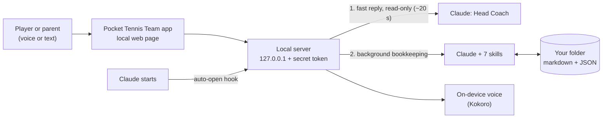

# 🎾 Pocket Tennis Team

**A whole professional tennis team behind every player: a Head Coach you can talk to, backed by six specialists, running on Claude.**

> **New name:** Pocket Tennis Team (formerly Tennis Team). The plugin ID, repo and install commands stay `tennis-team`.
>
> **v0.2 Preview.** Early version, built and tested end to end, with some rough edges. Feedback is very welcome.

After a practice or match, just talk. Your Head Coach listens, the team remembers everything, spots your patterns, and keeps a small, evidence-based plan: at most three things to work on each week, plus one fitness block. Every item comes with a **Why?** that quotes your own words.

**▶ [Try the live demo](https://daydreamingsheep.github.io/tennis-team/demo/?demo=1)** in your browser, with sample data and no install. · [Project site](https://daydreamingsheep.github.io/tennis-team/) · [Case study](https://daydreamingsheep.github.io/tennis-team/case-study/) · [Timeline](https://daydreamingsheep.github.io/tennis-team/timeline/)

---

## Why I built it

Club and junior players get advice from everywhere: lessons, YouTube, teammates, parents. Almost none of it is remembered, connected or turned into a plan. A pro player has a coach, an analyst, a fitness coach and someone tracking every match. Pocket Tennis Team gives an everyday player the same structure. It's voice-first for people who'd never open a spreadsheet, and parent-operated for junior players.

## Highlights

- **Talk to your coach.** Hands-free voice conversation with a natural on-device voice (36 voices, English and 中文), replies written to be spoken, an instant acknowledgement while the team thinks, and the option to interrupt.
- **A plan you can trust.** A short interview builds your plan live on screen. Every focus shows who decided it, why, and the words of yours it came from.
- **A real team, not one chatbot.** Seven specialists, each a Claude skill with its own job and rules (below).
- **Small and evidence-based.** One good session is "something we're watching"; it takes repeated evidence to "level up". Your real coach's advice outranks videos and general tips.
- **Health first.** Pain is always answered first: tightness is monitored, pain pauses the related work, limping means stop now. Junior growth guardrails (e.g. Sever's), overload warnings before you enter a tournament, and "not medical advice" every time.
- **Tournaments handled.** Entry deadlines, the lighter week before an event, match game plans, debriefs and the event reflection.
- **Private by default.** Everything lives in your own folder as plain files. The app runs only on your computer.

## Your team

Some members **learn from you** (you teach them), some **follow your style** (a few choices), and one is **automatic**.

| Team member | Kind | What they do |
|---|---|---|
| 🎾 **Head Coach** | Learns from you | Your front door. Learns from your lesson notes, the videos and links you follow, and what works on court. Brings in the right teammate |
| 🔍 Coach Analyst | Behind the Head Coach | Keeps your coaches' teaching straight, studies saved links, checks your ideas against it |
| 🧰 **Team Manager** | Automatic | Interviews you and sets up your team and starter plan |
| 📓 **Journal Keeper** | Follows your style | Turns messy notes into a clean training diary and spots repeating patterns |
| 🗺 **Planner** | Follows your style | When and how much: goal, timeline, days a week and intensity |
| 🏆 **Tournament Coach** | Follows your style | Calendar, entry deadlines, guides, game plans, debriefs and reflections |
| 📈 **Progress Coordinator** | Automatic | Each week decides what to keep, level up, simplify, rest or swap, on fixed rules you can read |

Joining later: Fitness Coach (learns from your physio notes and gym program), Player Scout, Nutrition and Stats. See the [roadmap](ROADMAP.md).

## How it works



- **Claude plugin:** skills, a SessionStart hook and a small standard-library Python server. No accounts and no cloud backend.
- **Two-pass replies:** a fast read-only answer, then the skills update the journal, plan and calendar in the background. Message time went from about 3 min to about 20 s.
- **One data contract:** the app renders from `_system/state.json`; the skills keep the markdown journal as the evidence history. See [`design/v0.2-architecture.md`](design/v0.2-architecture.md).

## Design process

Built like a product, not just a script:

1. **Personas and jobs:** Sam, a recreational adult player, and Mei, a parent running it for 14-year-old Alex. Each has their top tasks mapped. See [`design/design-brief.md`](design/design-brief.md).
2. **Clickable prototypes,** reviewed by me as the product owner.
3. **Persona testing:** AI agents role-played each persona through onboarding, daily training and tournaments, while a designer agent fixed what they found. Five rounds in total:

   | Persona | First test (v2) | Final (v3) |
   |---|---|---|
   | Sam (adult) | Onboarding 3 · Daily 2 · Tournaments 2 | Interview 4 · Plan review 4.5 · Home and daily 4.5 · Tournaments 4.5 |
   | Mei (parent) | Onboarding 3 · Daily 3 · Tournaments 2 | Interview 4 · Plan review 4.5 · Family Home 4.5 · Tournaments and health 4.5 |

   Smoothness scores out of 5; both personas' final verdict was "ready to show".
4. **Real end-to-end tests** with the live AI. These led to the two-pass reply design, the natural voice, and several safety fixes.

## Get started (Claude users)

You need the Claude desktop app or Claude Code, Chrome, Edge or Safari, and Python 3.

```
/plugin marketplace add DayDreamingSheep/tennis-team
/plugin install tennis-team@tennis-team
```

Then start Claude. The app opens by itself:

1. Pick a folder: Documents/Tennis, or iCloud Drive/Tennis if you want to drop voice memos from your phone.
2. Have a 2-minute interview with your Head Coach.
3. Talk after every practice or match.

**Opening it again:** start Claude in your Tennis folder, double-click **Open Pocket Tennis Team** in that folder, or say "open the app". You can turn off **Open automatically** in Settings. For the natural voice, go to **Settings → Voice → Download natural voice** (about 360 MB, once, free and offline).

On a Mac without developer tools, the first run may ask to install Apple's command line tools. Click **Install**.

## Privacy and safety

- **Your data:** everything stays in your folder on your computer. The local app only accepts connections from your own machine, with a secret token.
- **Voice:** the natural voice runs on your Mac. Speech recognition uses your browser's speech service. A premium cloud voice is optional and uses your own key.
- **Training links:** YouTube and other links are saved with their public title and channel only. Nothing is downloaded or scraped, and your own takeaways become the coaching notes.
- **Health:** this is a training tool, not medical advice. Junior players are parent-operated in this version.

## For developers

```bash
claude --plugin-dir .                 # run locally
claude plugin validate --strict .     # validate
python3 app/server.py --workspace ~/Tennis --open   # run the app on its own
```

| Path | What's there |
|---|---|
| `skills/` | One folder per team member (`SKILL.md` + references and assets) |
| `app/` | `server.py`, `launch.py`, `voice.py` + `tts_worker.py` (Kokoro), `net.py`, and `web/index.html` (the app; add `?demo=1` for demo mode) |
| `hooks/hooks.json` | Auto-open on Claude startup |
| `design/` | Brief, build contract, flow report, voice samples |
| `prototypes/` | Earlier clickable prototypes (v1–v3) and archived v0.1 files |

## License

Source-available under the [PolyForm Noncommercial License 1.0.0](LICENSE.md). You may read, run, modify and share it for personal and other noncommercial use. Commercial use needs written permission from the author.

Built by Andy(Chengyuan) Ke.
