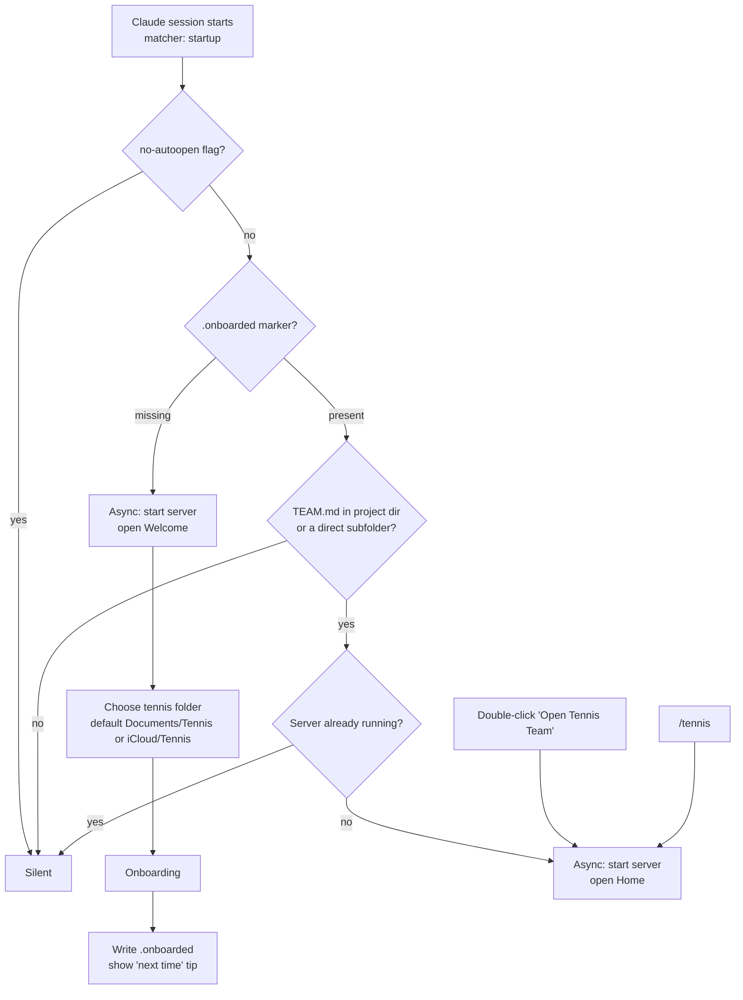
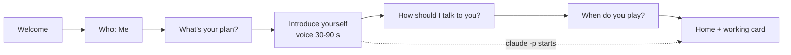
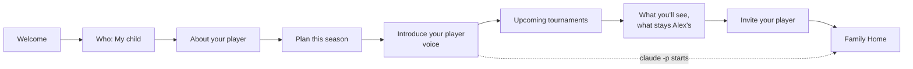
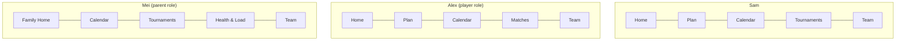

# Tennis Team: Design Brief v1

**Author:** Product design · **Date:** 2026-10-15 · **Status:** Draft for product owner review
**Scope:** personas, tasks, features, launch + onboarding, task-first conversation, IA, roadmap. No production code.

> **Decisions, 2026-10-15 (product owner).** These override the sections below where they conflict.
>
> 1. **Juniors are parent-operated in v0.2.**
>    - Claude consumer accounts are 18+. The parent owns and runs the app, and the teen talks to the coach with the parent present.
>    - **Cut from v0.2:** the teen role, PINs, the role switcher, the teen-only onboarding (5c), and private "just for me" notes. They return only after a policy review on minors.
>    - **Kept:** Family Home, Health & Load, sideline notes, "How do I talk about today?", the load meter, and the growth guardrails.
>    - The parent flow's "Invite your player" becomes **"Talk with Alex"**. The parent hands Alex the mic, and Alex's words are stored as `PLAYER` evidence, which outranks parent-reported fields.
> 2. **Auto-open as designed** (Section 4): first session after install → Welcome once; afterwards only on `startup` in a `TEAM.md` folder; in-app opt-out.
> 3. **Next step:** a clickable prototype of these flows (`prototypes/app-v2.html`) before any production build.
> 4. **Voice recognition (decided 2026-10-15): clean-up plus optional Whisper.**
>    - Browser speech-to-text stays as the live preview.
>    - After each recording, a clean-up pass fixes likely tennis mishearings (labels → level, valley → volley) and highlights them, with Undo. The transcript is always editable in place.
>    - In the real app, the coach also repairs names and context.
>    - Settings → "Better voice recognition" sets up on-device Whisper for free: about 500 MB, private and offline, primed with tennis words plus the player's and coaches' names.
>    - A cloud speech-to-text API is out for now (key, cost, privacy).
> 5. **Still open:** Q4 (sideline notes as observer evidence: accepted for parent mode), Q5 (phone: voice memos first), Q6 (one folder per player). The defaults stand unless changed.

**Goal in one line:** someone who has never typed a command starts Claude, the app is already on screen, and within about three minutes they have talked to their coach and have a plan for this week.

**Three principles**

1. **The page is the product.** Nobody types into Claude or says "voice mode". Claude Code / Cowork is the engine behind the page.
2. **Tasks, not a blank chat.** Every screen opens with the 2-3 things this person most likely came to do. The mic is always one tap away.
3. **Never make anyone wait on the AI to keep going.** Whatever the page can do itself (record, ask scripted questions, write setup files, show the plan) happens instantly. `claude -p` runs in the background and its result arrives as a card.

---

## 1. Personas

### 1a. Sam: recreational adult player

| | |
|---|---|
| **Snapshot** | 44, product manager, parent of two. NTRP 3.5, one-handed backhand. League doubles on Tuesdays, hitting on Saturdays, a lesson every other week with Coach Maria, 1-2 club tournaments a year. |
| **Goals** | Reach 4.0 in 12 months. Stop "losing the same way". Keep what paid lessons teach. |
| **Frustrations** | Forgets the coach's advice. Practices whatever is fun. Notes apps become graveyards. Doesn't want another login. |
| **Tech comfort** | Medium. Mac + iPhone, has the Claude desktop app, has never opened a terminal. Will click "Allow microphone"; will not edit config. |
| **Context** | Car after a match (phone voice memo now, live app later). Laptop on Sunday evening. Five minutes before a lesson. |
| **Success** | "I walk on court knowing my one thing. I talk for 60 seconds after a match and my coach remembers it." |
| **Quotes** | "I just want someone to remember what Maria told me." · "Don't give me ten drills. Give me one." · "If I have to type it, I won't." |

### 1b. Alex: teenage competitive player

| | |
|---|---|
| **Snapshot** | 14, 9th grade. UTR 7.4, two-handed backhand, aggressive baseliner. Academy 4-5 days a week plus a private coach. Tournaments most weekends (sectional juniors, UTR events), high-school team in spring. Had Sever's heel pain at 12; still growing. |
| **Goals** | UTR 8.5 and a top-50 sectional ranking. College tennis later. Stop "going away" after losing a tight first set. |
| **Frustrations** | Too many adults giving instructions. Post-match car talks feel like interrogations. School plus travel. Doesn't want a parent reading private feelings. |
| **Tech comfort** | High, but low patience. Prefers talking, short answers, no lectures. Uses the family laptop or a school laptop. |
| **Context** | Right after a match (phone, later phase). Evenings after training. The night before a match. |
| **Success** | "I have my own game plan. The coach in the app is on my side, not a spy for my parents." |
| **Quotes** | "Can it just tell me what to do against lefties?" · "My mom doesn't need to read this part." · "I lost 6-7 4-6 and I don't want to talk about it yet." |

### 1c. Mei: parent of a competitive junior (a distinct role)

| | |
|---|---|
| **Snapshot** | 46, Alex's mother. Pays for the academy, lessons and travel. Runs entries, hotels, school absence notes and physio. Owns the Claude account (see Safety for minors, Section 8). |
| **Goals** | Alex develops, stays healthy and keeps grades up. Good calls on which events to enter and when to rest. No fights in the car. Knows when to escalate. |
| **Frustrations** | Entry and withdrawal deadlines are scattered. She can't tell whether the academy, the private coach and the tournament load fit together. Alex shares little. She worries about overuse and growth spurts. |
| **Tech comfort** | Low to medium. Email, calendar, WhatsApp. Follows three clear steps; quits at the first error message. |
| **Context** | Laptop on weeknights for planning. Phone in the stands on weekends. Sunday family check-in. |
| **Success** | "One page tells me what's coming, what's due, and whether Alex's body is OK, and how to support without coaching." |
| **Quotes** | "I just need the entry deadlines." · "Is four tournaments in five weeks too much?" · "Tell me what to say in the car, and what not to." |

---

## 2. Jobs and tasks

**Entry points:** **Tile** = Home task tile · **Prompt** = a contextual card that appears on its own · **Voice** = a phrase that works by mic or typing. ★ = hero task.

### 2a. Sam

| ★ | Task | Trigger | Freq. | Today's pain | Entry point | Handled by |
|---|---|---|---|---|---|---|
| ★1 | Tell my coach how it went | Walking off court, in the car | 2-3/wk | Notes lost; typing is a chore | Tile "How did it go?" · Prompt after a scheduled session · Voice "I just played…" | Head Coach → Journal Keeper |
| ★2 | Know my one thing | 10 min before playing | 2-3/wk | Practices randomly | Tile "Today's focus" (instant, no AI) | Head Coach (reads plan) |
| ★3 | Save what my coach taught | After a lesson | 2/mo | Lesson content evaporates | Tile "After my lesson" · Voice "Maria told me…" | Coach Analyst |
| ★4 | Get ready for a match | Day before | 1-4/mo | No plan, nerves | Tile "Match coming up" · Prompt from the calendar | Tournament Coach |
| ★5 | See if I'm improving | Sunday | Weekly | No sense of progress | Prompt "Your weekly check-in is ready" | Progress Coordinator |
| | Report tightness | After a session | As needed | Ignored until it's an injury | Inside the ★1 template · Voice "My shoulder is tight" | Head Coach (health rule) |
| | Rethink the long-term goal | Quarterly | Rare | — | Plan → "Is my plan still right?" | Strategy Coach |

### 2b. Alex

| ★ | Task | Trigger | Freq. | Today's pain | Entry point | Handled by |
|---|---|---|---|---|---|---|
| ★1 | Debrief a match, in my own time | 30 min to hours after | 2-6/wk in season | Car interrogations | Tile "Debrief a match" · Prompt "Match vs. J. Park is done. Debrief when you're ready." | Tournament Coach → Journal Keeper |
| ★2 | Game plan for my next match | Night before / between rounds | 2-6/wk | No plan, or a parent's plan | Tile "Plan my next match" · Voice "I play a lefty pusher tomorrow" | Tournament Coach |
| ★3 | Quick practice log | After training | 4-5/wk | Too long, so skipped | Tile "Quick log" (3 questions, under 60 s) | Journal Keeper |
| ★4 | Body check | Morning / after a heavy day | Daily in tournament weeks | Hides soreness | Tile "Body check" (tap a body map, 0-3) | Head Coach (health rule) |
| ★5 | My focus this week | Monday | Weekly | Three coaches, three messages | Tile "My focus" (instant) | Progress Coordinator |
| | Vent privately | After a bad loss | Occasional | Nowhere private | "Just for me" toggle on any recording | Journal Keeper (private) |
| | Save academy / private-coach advice | After a lesson | 2-3/wk | Conflicting advice | Tile "After my lesson" | Coach Analyst |

### 2c. Mei

| ★ | Task | Trigger | Freq. | Today's pain | Entry point | Handled by |
|---|---|---|---|---|---|---|
| ★1 | Plan the tournament schedule | Monthly; new events announced | 2-4/mo | Scattered deadlines, overload | Tile "Add a tournament" (form, voice, or paste a link) | Tournament Coach + load check |
| ★2 | Weekly family brief | Sunday | Weekly | Doesn't know how to help | Prompt "This week's family brief is ready" | Progress Coordinator (parent view) |
| ★3 | Is Alex OK? | After a heavy weekend; pain mentioned | Weekly+ | Can't see load | Home "Load and body" card (instant) · Voice "Is this too much?" | Head Coach (health rule) |
| ★4 | Sideline note | In the stands | Most weekends | Notes become a car lecture | Tile "Sideline note" (saved as an observer note) | Journal Keeper |
| ★5 | How to talk about today | Before the car ride | Weekly | Conflict | Tile "How do I talk about today?" | Head Coach (parent guidance) |
| | Logistics: travel, school, physio | When booking | Monthly | Spreadsheets | Tournament card → "Travel & school" checklist | Tournament Coach |

---

## 3. Feature needs matrix

M = Must (MVP) · S = Should (Next) · L = Later · — = n/a. **Proto:** ✓ in the prototype, ◐ partly there, ✗ new.

| Feature | Adult | Teen | Parent | Proto |
|---|---|---|---|---|
| Auto-open app (SessionStart hook + launcher) | M | M | M | ✗ |
| "What's your plan?" onboarding question | M | M | M | ◐ dream + timeframe |
| Voice intro: "Introduce yourself to your coach" | M | M | M (introduces Alex) | ✗ |
| Team picker in onboarding | L (move to Team tab) | L | L | ✓ demote |
| Coach tone | S | M (short & straight) | S | ✓ |
| Home with role-specific task tiles | M | M | M | ◐ 3 chips |
| Guided voice templates (local questions, one AI call) | M | M | M | ✗ |
| Contextual prompts | M | M | M | ✗ |
| Live progress steps with avatars | M | M | M | ✓ |
| Non-blocking background jobs + result cards | M | M | M | ✗ |
| Reply feedback chips | M | M | M | ✓ |
| Tickable next-step cards (max 3) | M | M | S | ✗ |
| Plan tab | M | M | S (summary) | ✓ |
| Calendar | M | M | M | ✓ |
| Tournament guide | M | M | M | ✓ |
| Deadlines + travel/school checklist | L | S | M | ✗ |
| Load meter (sessions, matches, hours) | S | M | M | ✗ |
| Body check | S | M | M (view) | ✗ |
| Growth/overuse guardrails | — | M | M | ✗ |
| Role switcher ("Who's here?") + optional PIN | — | M | M | ✗ |
| Private "just for me" notes | — | M | — (sees that one exists) | ✗ |
| Observer (sideline) notes | — | S (coach summary) | S | ✗ |
| Weekly family brief; "how to talk about today" | — | — | M / S | ✗ |
| Coach knowledge library | S | S | S | ✓ |
| Inbox voice memos via iCloud/Drive (UI for it) | S | S | S | ◐ skill only |
| UTR / ranking tracking (manual) | L | S | S | ✗ |
| Google Calendar sync | L | S | S | ◐ button only |
| Two-device family sync | — | S | S | ✗ |
| Phone access (LAN HTTPS or hosted) | L | S | S | ✗ |
| Stats import, multi-player | L | L | L | ✗ |
| Languages (EN, 中文, ES, FR, 日本語) | M | M | M | ✓ |

---

## 4. Launch and first-run flow

### Platform facts (verified against the Claude Code docs)

- A plugin can ship `hooks/hooks.json` with a **SessionStart** hook (matchers `startup|resume|clear|compact`).
  - With `"async": true` it doesn't block session start, its output is discarded, and it can start a background server (`nohup … &`).
  - These hooks run in the CLI, the Desktop Code tab, and Cowork.
- Available paths: `${CLAUDE_PLUGIN_ROOT}`, `${CLAUDE_PLUGIN_DATA}` (persistent per-plugin folder), `${CLAUDE_PROJECT_DIR}`.
- **No install-time hook.** The app first opens at the **first Claude session after install**.
- **Hooks can't prompt the user.** Every "ask first" choice lives in the app page, which writes flag files that the hook reads.

### Recommendation

Use an **async SessionStart hook (matcher `startup` only)** as the primary door, with two backups:

1. `${CLAUDE_PLUGIN_DATA}/no-autoopen` exists → do nothing.
2. `${CLAUDE_PLUGIN_DATA}/.onboarded` **missing** → first run. Start the server and open **Welcome**, wherever the session started.
3. Marker present → open **Home** only if `${CLAUDE_PROJECT_DIR}` (or a direct subfolder) has `TEAM.md` and no server is already running for it. A PID/port file in `${CLAUDE_PLUGIN_DATA}/servers/` tracks that.
4. Otherwise silent. After the first run, non-tennis sessions are never touched.

**Doors compared**

- **A. Hook.** The only door that needs zero typing. Its costs: the first run may open in an unrelated folder, and it can't ask first. **Primary.**
- **B. Double-click `Open Tennis Team.command` / `.bat`.** Setup writes it into the workspace. It works without opening Claude and can be pinned to the Dock. It needs the `claude` CLI on PATH, and Gatekeeper may warn once. **Daily backup.**
- **C. `/tennis`.** Reliable, but requires typing. **Fallback only;** it's mentioned once in Team settings.

**Where does the workspace go if the first run starts in an unrelated folder?** Welcome decides, not the hook:

- Welcome asks: "Where should your team keep your tennis notes?"
- The default is `Documents/Tennis`. If iCloud Drive exists, the default is `iCloud Drive/Tennis`, labeled "lets you add voice memos from your phone".
- If the current folder is empty or tennis-named, Welcome also offers "Use this folder".

`.onboarded` is written when onboarding finishes or is skipped. The final screen says: *"Next time, just start Claude in your **Tennis** folder, or double-click **Open Tennis Team** inside it."*

**Opt-out.** Welcome has a small "Don't open this automatically" link. Team → App settings has a switch, "Open automatically when I start Claude in my tennis folder". Both write `no-autoopen`.

**New non-AI server endpoints** (so setup feels instant):
- write onboarding answers;
- run `init_workspace.py`;
- write the marker and flag files;
- read `plan-data.js`;
- append a raw note to `inbox/`;
- tick an action.

### First run, screen by screen

| # | Screen | What happens | Time |
|---|---|---|---|
| 0 | First Claude session after install | Hook starts the server and opens the browser; Claude's chat is unaffected | 2-3 s |
| 1 | **Welcome** | "Hi, I'm your Head Coach. Let's set up your tennis team. It takes about two minutes." Folder (pre-selected) · **[Let's go]** · "Don't open this automatically". The workspace is created without AI in under 1 s. | 10 s |
| 2 | **Who is this for?** | *Me* · *My child* · *I'm a junior joining my family's team* | 5 s |
| 3 | Onboarding (Section 5) | Plan, voice intro, tone, schedule | 1-2 min |
| 4 | **Home**, with a "Your team is reading your intro…" card | First `claude -p` (about 2 min) runs in the background; Plan and Calendar are browsable meanwhile | — |
| 5 | **First useful moment** | "Your coach's first message" (read aloud) + "This week": 1-3 focuses + "Open your plan" | about 3 min from Welcome |

---

## 5. Onboarding flows

**Rules for all flows**

- Every screen has a visible **Skip** and needs at most one tap. Six screens maximum.
- Answers are written by the server directly (no AI): `player/onboarding.json`, the voice intro as `inbox/YYYY-MM-DD-intro.md`, and finally the `.onboarded` marker.
- There is exactly **one** `claude -p` run. It starts the moment the intro is submitted (or onboarding is skipped) and runs setup Path A on the intro, with the onboarding answers as context. Everything else is learned over time (TEAM.md rule 13).

**Hiding the first-run latency**

1. Start the job at the intro screen, not at the end of onboarding.
2. Fill the wait with useful non-AI screens (tone, schedule, mic check).
3. Land on Home with a live progress card that uses the server's existing friendly steps ("Setting up your team folder", "The journal keeper is writing it down").
4. On completion: soft chime, tab title "(1) Your coach replied", and read aloud if the page is focused.
5. If the tab was closed, the reply waits in `_system/replies/` and shows on next open.

### 5a. Adult (Sam)

**S1. What's your plan?** (anchors the Strategy Coach; no typing)
- Headline: **"What's your plan with tennis?"** · Sub: "Pick the closest one. You can change it anytime."
- Buttons: "Move up a level (e.g. 3.5 → 4.0)" · "Win more league matches" · "Get ready for a tournament" · "Play more and stay healthy" · "Fix one thing that drives me crazy" · "Something else 🎙".
- Optional "By when?": No rush / 3 months / 12 months. Writes `onboarding.json.plan`, `.by`.

**S2. Introduce yourself to your coach** (the voice moment; replaces the four setup questions)
- Headline: **"Introduce yourself to your coach"** · Sub: "Just talk, like at your first lesson. About a minute is perfect."
- Prompt card beside the mic. Items tick off as the live transcript mentions them:
  - "Your name and how long you've played"
  - "Your level, if you know it (NTRP, UTR, or 'club player')"
  - "What loses you the most points"
  - "Anything sore or injured"
  - "Your coach's name, if you have one"
- UI: big green mic, live transcript, timer ring (soft stop at 2:00), "Type instead", **Skip**.
- After recording: *"Got it. Your team is reading this now. Two more quick taps while they work."*
- **Extracted:**
  - name, level, years playing, backhand type;
  - top point-losers → P0; strengths;
  - health → rule 9;
  - coaches → Coach Analyst folders;
  - schedule hints and goals.
  - Unknowns stay `unknown`.
- **Written:** `player/profile.md`, `training/priorities.md`, `journal/patterns.md`, the first `weekly_assignments.md`, `plan-data.js`.

**S3. How should I talk to you?** "Encouraging" · "Balanced" (default) · "Straight-talking", each with a ▶ sample line (already in the prototype). Plus "Read replies aloud" (on) and the voice picker.

**S4. When do you usually play?** Seven day-chips, each set to Practice / Match / Lesson. "Skip: I'll tell you as I go." Seeds Calendar planned sessions and after-session prompts.

**S5. Home.** Card: "🎾 Your Head Coach is reading your intro… usually about 2 minutes." Under it: "While you wait: ▶ Hear your coach's voice · 📅 See your week · 🔔 Chime me when they reply."

**If S2 is skipped**, the job runs on the plan and schedule only. First message: *"Your team is ready. After your next practice, tap **How did it go?** and just talk."*

### 5b. Parent setting up for a teen (Mei)

**S1. About your player.** "Who are we coaching?" First name; age band **12 and under / 13-15 / 16-18**; level (UTR, ranking, or "not sure"). Choosing 12 and under shows: *"For players 12 and under, you'll use the app together. Your player won't get their own role."*

**S2. What's the plan this season?** "Raise UTR / ranking" · "Get ready for a big event" · "High-school season" · "College path" · "Stay healthy and enjoy it" · "Something else 🎙". Plus "By when?"

**S3. Introduce your player (voice).**
- Headline: **"Tell the coach about Alex"** · Sub: "What would you tell a new coach in the first five minutes?"
- Prompt card: "How long they've played and where they train" · "What they're great at" · "What costs them matches" · "Injuries or growth pains" · "Who else coaches them".
- Footer: *"Alex will tell the coach their side too. Their own words count most."*
- Stored as `PARENT` evidence, lower authority than the player and `DIRECT` coach sources. Profile fields are tagged "reported by parent". Health items are always kept.

**S4. Upcoming tournaments.** "Any tournaments coming up?" Three quick rows: name, date, "entry deadline if you know it". Or "Paste a link". Appended to `tournaments/calendar.md` (no AI).

**S5. What you'll see, and what stays Alex's.** Pre-filled; passed with one tap, but never hidden.
- *"**You'll always see:** the weekly plan, calendar and tournaments, training load, and any pain or injury flag."*
- *"**You'll see summaries of:** match debriefs and practice notes."*
- *"**Alex can keep private:** notes marked 'just for me'. You'll see that one exists, never what it says."*
- *"Teens share more when they trust the space. We recommend these defaults."*
- Toggle "Show me full match debriefs", off by default. If it's turned on, Alex sees a banner saying so. Writes `family/sharing.json`.

**S6. Invite your player.** **"Now let Alex meet the coach."**
- "Alex is here now" → switches role and goes to 5c.
- "Later on this computer" → Home shows a "Waiting for Alex" card.
- "On Alex's own computer" → three illustrated steps to share the folder via iCloud or Google Drive (a v0.3 feature; shown as "coming soon" in MVP).
- Optional 4-digit PIN per role: *"A PIN keeps casual peeking out. It isn't a lock."*

### 5c. Teen joining (Alex). Three screens, short and peer-toned.

**S1.** **"Hey Alex. This is your coach, not your parents' report card."** Sub: "Your mom set things up. Here's what she can and can't see." A two-line sharing summary, then **[Got it]**.

**S2. In your own words (voice).** **"What's your game?"**
- Prompt card: "How you like to win points" · "What's frustrating you right now" · "One goal that's yours, not anyone else's" · "Anything hurting".
- The intro is shared as a summary. A "Keep the details private" toggle is off by default.
- Stored as `PLAYER` evidence that outranks parent-reported fields. Conflicts stay visible in `journal/patterns.md`.
- The teen's goal goes to `player/goals.md` as "Alex's goal", next to "Family plan".

**S3. How should your coach talk to you?** "Short and straight" (teen default) · "Balanced" · "Hype me up". Read aloud defaults to **off** for teens.

→ **Teen Home**, with the "Your coach is reading what you said…" card.

**Written for families:**
- `player/onboarding.json` (answers tagged by role)
- `family/sharing.json`
- `family/roles.json` (names, PIN hashes)
- `inbox/*-intro-parent.md` and `inbox/*-intro-player.md`
- tournament rows

---

## 6. Task-based conversation design

### 6a. Home replaces "Talk"

Same skeleton for every role:

1. **Today card**, instant, read from `plan-data.js` and the calendar. Examples: "Today: Practice 6 pm · Your one thing: *Split, first step forward*" or "Rest day 🌙".
2. **One contextual prompt** (or none).
3. **Task tiles**: 4-6, large, icon plus a verb phrase.
4. **Big mic**: "Or just tell your coach anything", with a text box under it.
5. **Recent conversation**, collapsed. It persists via `_system/conversation.jsonl`, which closes a roadmap "Ideas" item.

| Sam | Alex | Mei |
|---|---|---|
| 🎙 How did it go? | 🎙 Debrief a match | 🏆 Add a tournament |
| 🎯 Today's focus | 🗺 Plan my next match | 📋 This week's brief |
| 👩‍🏫 After my lesson | ⚡ Quick log | ❤️ Load and body |
| 🏆 Match coming up | 🩹 Body check | 📝 Sideline note |
| 📈 How am I doing? | 🎯 My focus | 💬 How do I talk about today? |

### 6b. Contextual prompts

Prompts come from local rules, not AI. Only the highest-priority prompt shows. "Not now" snoozes it for 12 h.

| # | Condition | Copy | Opens |
|---|---|---|---|
| 1 | Health flag 1-3 days ago | "How's your calf today?" Better · Same · Worse | "Worse" → rule 9 pause |
| 2 | Match ended 30+ min ago, no note | Alex: "Match vs. J. Park is done. Debrief when you're ready, no rush." · Sam: "How did league go tonight?" | Debrief / T1 |
| 3 | Practice ended 1-6 h ago, no note | "How did practice go? 30 seconds is enough." | Quick log |
| 4 | Match within 24 h | "Match tomorrow. Want a 2-minute game plan?" | T3 |
| 5 | Weekly review ready | "Your weekly check-in is ready" / Parent: "This week's family brief is ready" | Review card |
| 6 | Entry deadline within 5 days (parent) | "Entry for Fall Junior Open closes Friday." | Entered ✓ · Skip this one |
| 7 | 3+ tournament weekends in 4 weeks | "That's a heavy month. Want the coach's take on load?" | Load check |

### 6c. Guided voice templates

**The key design move:** questions are scripted **in the page**. The user answers each one by voice with no AI wait in between. The answers are joined into one structured note and sent as **one** `claude -p` job. That turns four 30-second waits into one, and it runs in the background.

Template UI: one question per screen, big mic, "Skip question", "That's all, send it", progress dots, 90 s soft limit per answer.

**T1. How did it go?** (Sam. Alex's Quick log uses 1, 3 and 5.)
1. "Practice, match, or lesson?" (buttons)
2. "What happened? Score, who you played, anything." (matches only)
3. "How did your one thing go: *split, first step forward*? Roughly how many out of ten?"
4. "What cost you the most points?"
5. "Anything sore or tight?" (No · A little · It hurts). "It hurts" puts a health flag first, so rule 9 leads the reply.

**T2. Debrief a match** (Alex)
1. "Score and opponent? Just the facts for now."
2. "What was working?" (always before what went wrong)
3. "When did the match turn?"
4. "One thing you'd do differently next time?"
5. "How's your body?" (buttons)
6. "Keep this just for me?" (toggle)

**T3. Plan my next match** (Alex, Sam)
1. "Who are you playing? Lefty, pusher, big server…"
2. "What's your best pattern right now?"
3. "What's your one move if you're losing?"

The reply is a 3-line **match card** (Serve plan · Return plan · Reset cue), saved to the Tournaments/Matches tab.

**T4. After my lesson** (all)
1. "Which coach?" (chips from the Coaches table, plus "New coach")
2. "What did they tell you? Their words, if you remember."
3. "Anything you want to check you understood right?"

**T5. Sideline note** (Mei)
1. "What are you seeing? Facts only: scores, patterns, body language."
2. "Anything the coach should know: an injury, the conditions, a bad call?"

Confirmation: *"Saved as an observer note. The coach will use it. Alex sees a coach summary, not your words."*

**T6. How do I talk about today?** (Mei) One question: "Did Alex win or lose, and how did they seem?" The reply gives **2 things to say, 1 to avoid, 1 question for later**. For example: "Say: 'I loved how you kept fighting in the second set.' Avoid: replaying the double faults. Later: 'Want to tell your coach about it?'"

### 6d. Reply design (TEAM.md rules 7 and 12)

- **Credit line** with avatars (prototype), e.g. "Journal Keeper with Progress Coordinator".
- **Coaching message:** 2-4 short sentences, under 120 words when spoken.
- **Next steps:** at most 3 tickable cards, each with a verb and a when. Examples: "☐ Saturday: 10 live points, count your forward first steps" · "☐ Before Tuesday: calf raises 3×15". Ticking one writes `done` to `action_tracker.csv` without an AI call.
- **What changed**, as one quiet line: "Plan updated · Second serve → test in real points ›"
- **Feedback chips** (prototype): 👍 Helpful · Too long · Too soft · Not quite right.
- At most **one** question, at the end, with quick-reply buttons.

**Waiting state:** "Your team is working · usually 30-60 s", with streamed steps and "Keep using the app. I'll chime when they reply." The mic stays live: new notes queue behind the running job. This replaces the prototype's `setBusy` lock.

---

## 7. Information architecture

**Yes, the parent gets a different home.** The parent's job is logistics and support, not training.

| Area | Player (Sam / Alex) | Parent (Mei) |
|---|---|---|
| Home | Today, prompt, tiles, mic | Family brief, deadlines, load meter, tiles, mic ("Ask the coach as a parent") |
| Plan | Full: week, cues, block, roadmap | Inside Family Home: "This week Alex is working on…" + "How you can help" |
| Calendar | Sessions, note dots | Same, plus travel, school and physio events |
| Tournaments / Matches | Teen tab is "Matches": game plans, debriefs, results, UTR trend | Entries, deadlines, travel & school checklist, results; debriefs per sharing settings |
| Health & Load | Body check on Home | Own tab: weekly hours, matches per weekend, body flags, rest days |
| Team | As in the prototype | Same + Family settings (sharing, PINs, roles, auto-open) |
| Header | Name · level · role switch (families) | "Mei (parent) · coaching Alex" · role switch |

**Changes from the prototype**

1. **Talk → Home:** chips become tiles; add the Today card and prompt; the conversation collapses.
2. **Wizard rewritten:** drop "Meet your tennis team" as step 1 (everyone is on by default; toggles move to Team). Add the role fork, plan, voice intro, schedule, sharing and invite.
3. **Non-blocking job queue** replaces `setBusy`; replies arrive as result cards.
4. **Role switcher** and an optional PIN in the header.
5. **New screens:** Health & Load, deadline cards, sharing settings, private toggle.
6. **Next steps** become tickable cards; the conversation persists across reloads.
7. **Workspace additions:**
   - `family/` (roles, sharing, logistics), `player/onboarding.json`, `_system/conversation.jsonl`, `journal/private/`;
   - an `author_role` and a `visibility` field (`shared` / `summary` / `private`) on intake and entries.

---

## 8. Roadmap

### Now: v0.2 "App-first" (about 6 weeks, to end of Nov 2026)

**Goal:** a low-tech adult goes from install to a first plan without typing a command. Family mode works on one shared computer.

**Features**
- **Launch:** async SessionStart hook with the `.onboarded` marker and `no-autoopen` flag; launcher file; `/tennis`; folder picker.
- **Server:** non-AI endpoints.
- **Onboarding:** flows 5a/5b/5c on one device.
- **Home:** tiles, Today card, prompts 1-5, templates T1-T4.
- **Jobs:** queue, result cards, chime, persisted conversation.
- **Family:** role switcher + PIN; sharing enforced in page rendering **and** in what each `claude -p` run can read; body check; basic load meter; minors' safety rules (below).

**Success metrics**
- 80% of installs reach Home in 5 min or less.
- Median 3:30 or less from Welcome to the first coach message.
- 60% log a second note within 7 days.
- 70% or more of notes come from tiles, templates or prompts (not blank chat).
- Under 10% of sessions show a raw error.
- Families: at least one teen-authored note per parent-authored note.

**Risks**
- *First run opens in an unrelated folder.* Mitigation: `startup` only, once until onboarded, plus a visible opt-out.
- *Async `nohup` server lifetime on Windows.* The launcher is the fallback.
- *`claude` CLI missing on PATH* for Desktop-only users. The launcher detects this and shows a plain fix.
- ***Private-note leakage (must-fix):*** a prompt alone won't keep the AI from quoting a private note. Store private notes in `journal/private/` and exclude that path from parent-role runs (allowed paths / working directory scope).

### Next: v0.3 "Family on the go" (Dec 2026 – Feb 2027)

**Goal:** parent and teen on two devices; phone capture in the stands.

**Features**
- **Shared-folder sync (iCloud/Drive)** with **one writer per file**: the teen's device writes `journal/`, the parent's writes `family/` and logistics, and both drop uniquely named files in `inbox/`. Only the "home computer" runs weekly reviews. A lock file in `_system/` prevents two `claude -p` runs colliding.
- **Phone:** Step 1 is a voice memo → synced `inbox/`. Step 2 is LAN HTTPS with QR pairing.
- **Parent features:** templates T5-T6, family brief, deadlines + logistics.
- **Calendar and stats:** ICS export, manual UTR trend.
- **Fitness Coach** with growth-aware load rules.

**Metrics:** 50% of family workspaces active on two devices · parent brief opened on 70% of weeks · fewer than 1 sync-conflict file per family per month.

**Risks:** iCloud conflict copies; self-signed certificate warnings may scare parents, so LAN HTTPS may slip to Later.

### Later: v0.4+ "Connected team" (2027)

**Goal:** works anywhere, includes real coaches, uses real data.

**Features**
- Opt-in encrypted hosted sync and a phone PWA.
- A consented read-only weekly brief for a real coach.
- Stats Analyst (SwingVision, UTR imports) and Player Scout.
- Nutrition: adults first; juniors get general fueling only, never weight goals.
- Multi-player: siblings, or a coach with students.

**Metrics:** 8-week retention of 40% or more; coach-brief adoption.

**Risks:** leaving local-only breaks the privacy promise. Minors' data then needs consent flows, deletion, and a COPPA/GDPR-K review.

### Safety for minors (from Now)

- **Account:** the Claude account belongs to the parent. The teen uses the app under it on a family device, and parent onboarding says so plainly.
- **Health:** pain, injury or dizziness → pause the related work, "tell a parent or coach", and point to professional guidance. The parent always sees the flag line, even from a private note, but never the note text.
- **Growth guardrails (ages 12-15):**
  - warn after 2 tournament weekends in a row, or more than 4 singles matches in a day;
  - suggest rest after back-to-back match days;
  - heel or knee pain in a growing player → "see a physio".
  - All of this is labeled "not medical advice".
- **Wellbeing:** signs of distress, burnout, self-harm or disordered eating pause tennis coaching. The coach gives a warm, plain reply that encourages talking to a trusted adult and shows crisis resources.
- **Limits:** no weight or diet goals for minors, no public sharing, and the team never contacts anyone.

---

## 9. Open questions for the product owner

*Q1-Q3 were decided on 2026-10-15; see Decisions at the top. Q4-Q6 keep their defaults for now.*

1. **Age policy.** Claude consumer accounts are for adults. How do we support minors?
   **Default:** the parent owns the account. Ages 13-17 get a player role on the family device. Under 13 is parent-operated only.

2. **Teen privacy vs. parent visibility.** What can stay private, and what happens when a private note contains a safety concern?
   **Default:** debriefs are shared as summaries, and "just for me" notes are hidden. Health and wellbeing-risk flags always reach the parent as a one-line flag without the text. The teen is told this up front.

3. **Auto-open.** Is it OK that the first session after install opens the app wherever it starts, and that later sessions in the tennis folder always open it?
   **Default:** yes. The first run opens once, anywhere, until onboarding is done or skipped. After that it opens only on `startup` in a `TEAM.md` folder when no server is running. The in-app switch writes `no-autoopen`.

4. **Parent sideline notes.** Do they enter the teen's journal?
   **Default:** yes, as low-authority `observer` evidence. Alex sees only the coach's summary, never the parent's words.

5. **Phone timeline.** Build LAN HTTPS in v0.3, or rely on synced voice memos until hosted sync exists?
   **Default:** voice memos first. Try LAN HTTPS only if a usability test shows low-tech parents get through the certificate step.

6. **Workspace per player or per family?** This covers siblings, and a parent who also plays.
   **Default:** one folder per player, with a "switch player" list in v0.4. A parent who plays gets their own adult workspace.
